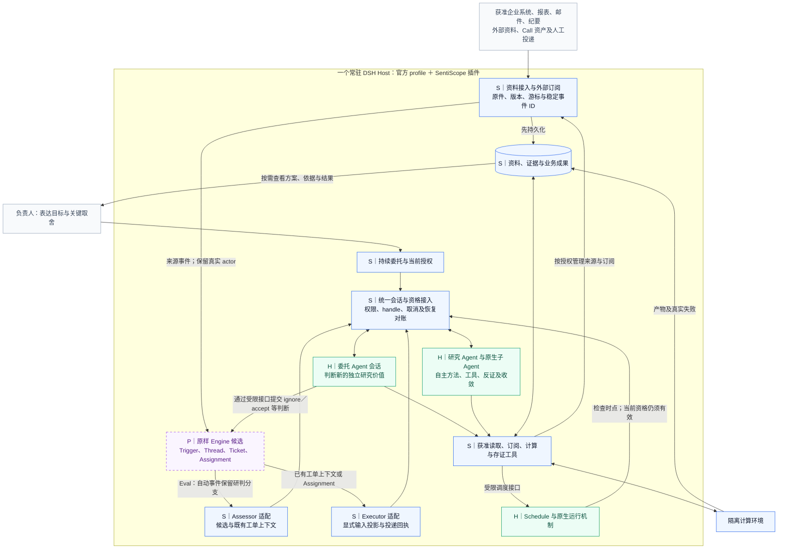

# SentiScope：DSH 技术架构方案 v0.2

设计内容日期：2026-11-11（Asia/Shanghai）；用户确认及仓库固化日期：2026-11-16。状态：已确认的技术架构设计基线，四原则设计复核 DESIGN_PASS。确认、原始候选身份及复核范围见[确认与复核记录](DSH_技术架构_v0.2_确认与复核记录.md)。本稿不构成开发、安装、模型、POC或部署授权。

## 1. 范围、依据与版本关系

用户在认同 v0.1 的 DSH 技术架构方向后，要求补齐 superagent 复用边界、失败恢复、事件路由、最简用户操作路径并复核四原则；v0.2 已于2026-11-16确认。本文承接该方向，取代 v0.1 中相应的含糊描述；不改变蓝图定位、自主范围或经营动作授权。

v0.1 原方案、原审核 F1–F4 和 v0.2 原件均在本地原样保留，其保存位置与哈希见[确认与复核记录](DSH_技术架构_v0.2_确认与复核记录.md)。v0.1 的完整审核未通过状态不追溯改写。当前规范仍为[工程规范](engineering-workflow.md)，产品方向仍为[蓝图 v0.4](OptraSentiScope_产品蓝图讨论稿_v0.4.md)。

研究接口基线：Harness 固定 66491b05e3f05ad35bcdd4f6cd7ed26041d9e3db；superagent 固定 8c32a9dc5d72c033816c6a8110b37f40cf94fba4。它们仅用于本稿的源码契约依据，不是组件采用、安装或升级决定。

| 审核项 | v0.2 的具体设计结果 |
| --- | --- |
| F1：core 内编码恢复指令 | 原文留在 core；通过公开 Executor 端口作可追溯输入投影，见第4节 |
| F2：failed/blocked 与自主恢复 | 明确错误分类、真实失败记录、恢复资格、原子状态与补读 note，见第5节 |
| F3：自动事件双路 | 保留原型实际双路行为，由 Agent 区分既有研究与新增问题，见第6节 |
| F4：必做人工作业不明 | 给出正常、异常、调整／暂停／恢复／结束的文字操作路径及反例，见第7节 |

本仓库版本仅调整归档元数据和导航链接；原固定候选、原始各轮复核及其身份保持不变。原设计复核结论与本次归档核对分别记录在[确认与复核记录](DSH_技术架构_v0.2_确认与复核记录.md)及[归档规格／结果](../openspec/changes/freeze-dsh-architecture-v02/spec.md)。

## 2. 拓扑与职责

一个常驻 DSH Host，以官方 dsh profile 启动，装载 SentiScope 自有 Cordis 插件。官方原实现承担 Agent 执行；自有插件提供产品接口、业务状态、受限资料工具与适配。计算使用隔离执行环境；插件同进程和工作目录本身不构成安全隔离。

S 是 SentiScope 自有模块；H 是直接复用 Harness；P 是原包接入候选。图中两个 Agent 是同一 Runtime 中的业务角色，不是固定分析阶段；普通研究可在当前会话完成，不要求先建工单或固定经过两个角色。

企业信息先保存原件／准确引用、版本、业务时间、获取／可知时间与权限，再提交事件；来源游标仅在对应记录可恢复后推进。模型按需读取变更与原文引用，不把所有大资料整份追加进上下文。人工投递是补充，已有来源和 Call 背景优先复用。Agent 输出和计算产物标明内部来源及因果关系，保存成果不自动制造新外部事件。

## 3. 复用分工与接入契约

### 3.1 明确采用范围

| 层面 | 设计分工与限制 |
| --- | --- |
| Harness 官方能力 | 原样使用 profile／Cordis、模型与工具注册、Agent／Session、持久 inbox、上下文与压缩、原生子 Agent、执行事件、权限、公开取消／恢复接口及 Schedule；原生 Goal 可服务有限研究工作，不是长期委托权威 |
| superagent 原包候选 | 通过根入口公开导出的 Engine／ports，复用事件、Thread、Ticket、Assignment、Decision、订阅、串行评估及去重状态逻辑；不挂载原编码应用 bundle，不调用原应用 apply |
| SentiScope 端口适配 | Policy／SourceScope 对接当前委托授权；Assessor 把专业判断交 Agent；Executor 负责实际输入构造与投递；Repositories 提供同步事务；Outbox 只承接授权产品消息与回执 |
| SentiScope 业务 | 企业来源适配、外部订阅含义、资料身份与版本、持续委托、证据、方案、采纳／执行／观察事实和经验修订、产品交互及计算环境 |
| 不继承部分 | 原应用 Runtime／Store／DshExecutor、编码 prompts、GitHub push 前提、danger-full-access 默认值、PR 结束含义、原型人为恢复习惯；core 中的恢复原文通过第4节显式投影，不能假定其已经场景无关 |

保持所有第三方源码、包产物、对象及内部方法原实现；不补丁、不 fork、不私有拆包替代、不 monkey-patch，不通过改 Repository 字段改变 Engine 语义。自有适配只使用公开端口和自有对象。若已选精确发行组合不能支持本文接法，撤回相应原样复用能力声明、收窄复用范围并保留原因；不以另一份影子工单引擎掩盖不兼容，也不自动扩大当前方案。

### 3.2 权威状态与存储

| 状态 | 唯一 owner |
| --- | --- |
| 目标、约束、当前研究授权版本、资源与委托生命周期 | SentiScope |
| Trigger／Thread／Ticket／Assignment／Decision 与工单订阅 | 采用时由原包 Engine |
| Agent／Session／inbox／turn／工具／子 Agent／会话历史 | Harness |
| 调度状态、到期与原生投递回执 | Harness Schedule；业务订阅只保存含义与 Schedule ID |
| 原件、版本、研究结果、故障事实、输入投影和补读关联 | SentiScope；引用原生证据，避免复制整份会话历史 |

业务事务库、资料文件库和 Harness 原生会话存储职责分开。core 的 Repositories.atomic 为同步契约：端口回调在事务内只保存工作意图，模型、网络、实际会话操作在提交后执行；涉及同一提交的业务回执使用同一事务库。故障事实和差量证据增量追加，不逐事件重写完整历史。

不重造 inbox、计时器、会话循环、上下文压缩、子 Agent、原生重试或全局业务调度。新增持久记录只补已经确认的缺口：原型当前 report 会被覆盖、held 输入不自动重排、note ID 带时间，以及自有资料到工单的跨存储投递；记录相应事实与关联，不复制权威运行状态机。

### 3.3 接入契约草案 v0.2（未实现）

owner 是企业授权域＋持续委托，必要时关联 Ticket／Assignment。Host 持有原生 AgentHandle、模型与凭据配置；业务模块只取得绑定 owner 的受限引用。每次异步回调核对当前委托版本、权限资格、Assignment、恢复 epoch 和原生 handle 代际。模型／工具／资料路径不能从外部消息中任意指定。

业务 Agent 通过按委托收窄的工具使用 Schedule；原生全 Host 管理资格不直接暴露。专业方法与研究节奏由 Agent 在资源上限内决定。正式 SDK 精确版本、隔离方式、数据存储组件、接口类型及可点击 UI 在后续适用方案中确认；本稿不声称接口已建立。

## 4. F1：编码恢复原文与研究输入的显式投影

core 的 assignmentInterrupted 会原样保存含 worktree／Git／GitHub 的恢复 text。本文不修改常量，也不把该原文逐字作为研究 Agent 指令。

Executor.start／deliver 是公开输入接缝，按以下契约构造实际模型输入：

1. 只识别有可核对来源的 Host 重启控制输入：前 Assignment 的 endedReason=hostRestarted、新 Assignment、对应 restart input ID 和固定来源版本相互匹配。身份不能证明时保留原输入与问题，不靠英文关键词过滤任意资料。
2. 原始 text、input ID、Assignment 历史与来源版本留在 core 和证据记录中，不删改或假报已逐字送入模型。
3. 实际上下文采用研究恢复含义：Host 中断事实、原研究问题、当前授权与资源、已有产物、原生投递／执行回执、待处理资料引用及 UNKNOWN。明确先核对已有成果与回执；不重做已确认完成的外部操作，也不添加固定研究方法。
4. 自有投递记录保存 raw input ID／原文引用、旧新 Assignment、投影版本、实际投影内容引用、原生消息 ID 及 admission／读取依据。inputsDelivered／inputsRead 仅按各自公开契约记录；generic text／note 的实际读取以原生回执及自有投影关联证明，不伪造旧 Trigger 的 readAt。
5. 投影是本产品输入组装，不修改 Engine、原始输入或 Harness 对象。若无法建立输入身份和实际消息映射，受影响输入不标成功；保留可见技术缺口，不让无关编码指令静默进入研究上下文。

设计来源：[Executor ports L55–68](https://github.com/deepseek-ai/dsh-superagent-prototype/blob/8c32a9dc5d72c033816c6a8110b37f40cf94fba4/src/core/ports.ts#L55-L68)、[恢复原文及调用](https://github.com/deepseek-ai/dsh-superagent-prototype/blob/8c32a9dc5d72c033816c6a8110b37f40cf94fba4/src/core/assignments.ts#L21)、[restart input L318–326](https://github.com/deepseek-ai/dsh-superagent-prototype/blob/8c32a9dc5d72c033816c6a8110b37f40cf94fba4/src/core/tickets.ts#L318-L326)。

## 5. F2：错误分类、真实失败与恢复

### 5.1 分类规则

| 情形 | Agent／Host 的处理 | 负责人动作 |
| --- | --- | --- |
| 可纠正的查询、代码、数据格式或分析错误 | 保留真实工具失败，反馈 Agent 在现有范围内改方法／调用；一次工具错误不等同 Assignment 失败 | 默认无需动作 |
| 明确可安全恢复的暂时运行故障 | 优先使用 Harness 已有且适用的有限恢复；逐次记录 Provider／Host 故障和费用影响，不另造无限重试 | 默认无需动作；真正需人恢复设备／凭据时交对应管理者 |
| 实际 Agent／Executor 工作失败 | 如实 report failed 并保留不可变故障事实；按5.2核对是否能安全恢复 | 不一概要求人工重启，必要时只询问不可替代事项 |
| 缺关键资料、口径或业务取舍 | 先查获准来源；Agent 可交付条件结果，受影响判断待定，其他研究继续 | 自主查找后仍有关键缺口时集中回答 |
| 权限失效、额外资源或新增外部影响 | 保留 blocked／待授权，不以技术恢复清除；授权外工作不启动 | 对应负责人决定；沉默、拒绝不授予权限 |
| 结果或外部副作用 UNKNOWN | 查现有状态、回执和产物，保留未知；不以超时推断失败，不盲重放或自动换模型 | 自动核对仍无法解决且需承担新影响时才请求决定 |
| 用户暂停、结束或撤权 | 阻止后续派发与受影响工具资格，安全停止并保留迟到结果 | 仅显式恢复或新委托可重新激活 |

错误分类依真实运行事实与当前授权，不是为了通过状态门槛。Host 不判断分析结论是否正确；专业纠错由 Agent 完成。受限工具约束资料、资源及副作用，不以固定方法清单压缩正常研究空间。

### 5.2 已进入 failed 后的公开恢复接法

原型 blocked／failed 会拦自动输入，并从 undelivered 移除相应自动项。后续真实非失败 report 可解除 hold，但不会自动补回旧输入。本稿明确采用“保留旧事实＋实际恢复确认＋新的事实型补读 note”，不把“重报 progress”当成完整恢复。

1. 原失败在更新当前 report 前写入增量、不可变故障证据，引用原生错误及原报告。Engine 的最新 report 后续变化不删除旧失败。
2. 仅对明确归类为可自动恢复的技术故障启动资源核对；委托、资料与费用授权必须仍有效。业务 blocked、用户暂停／结束／撤权、真实待决 attention、无法排除的 UNKNOWN 均不走自动解除。
3. 经官方接口恢复 matching Agent／handle，并核对原生 inbox、已派发工作、子 Agent、计算和副作用。此时业务派发保持关闭。仅“网络通了”不算恢复；必须能证明无未停止工作、当前 Agent 已实际可用且安全等待上下文。
4. 因 Engine.report 没有 Assignment ID 参数，提交前在同一事务中再次核对当前 Assignment、恢复 epoch、handle 代际、委托及权限版本、预算、暂停／结束状态，且 ticket.attention 为空。迟到旧恢复结果拒收并留痕，不影响新 Assignment。
5. 资格满足后，原子提交：真实 report waiting（含恢复证据引用，不表示研究成功）＋公开 Engine.note 的事实型恢复上下文＋稳定 epoch 对应的新 note ID／待投递记录。note 含原问题、原输入／资料引用、已知回执及未知，提供上下文而不授予新权限。专业处理仍由 Agent 决定。
6. 原 held inputs 的未投递状态保留。新的补读关系显式记录 new note → original input IDs／资料版本；只确认新 note 的实际投递／读取，不把旧输入伪造为已经消费。已读取不等于已解决；Agent 根据原会话与新事实判断后续研究。
7. Engine.note 的 ID 含当前时间，不能靠重复调用保证幂等。相同恢复 epoch 的 report、note 和自有关联在同一业务事务库一次提交；已提交 epoch 返回既有 note。Executor 在事务内只保存投递意图，原生调用在提交后发生。
8. 提交失败则旧失败状态继续有效、无派发；提交后崩溃恢复同一待投递记录；admission 回执丢失先查原生 inbox／会话与消息 ID，无法证明时记 UNKNOWN，不再生成第二条 note 或盲重送。资格失效时保留记录、停止派发。
9. 不调用 People-only retryTicket 来模拟自动恢复，不伪造 human，不直接改 Repository 或清空业务问题，不在失败 hold 未解除前直接给 Agent 发送研究任务。

这条接法基于公开契约，是本版明确的设计；实际事务、handle 恢复、资格钩子与原生 admission 对账尚未运行验证。无法满足任一必要条件时保持相应失败／未知及有限结果，由正确责任人处置确需人做的事项，不把整项委托或所有会话一律变成“等负责人重启”。

来源：[report 与 held inputs](https://github.com/deepseek-ai/dsh-superagent-prototype/blob/8c32a9dc5d72c033816c6a8110b37f40cf94fba4/src/core/assignments.ts#L99-L127)、[后续真实报告与 hold](https://github.com/deepseek-ai/dsh-superagent-prototype/blob/8c32a9dc5d72c033816c6a8110b37f40cf94fba4/src/core/model.ts#L345-L352)、[公开事实 note 及其 ID](https://github.com/deepseek-ai/dsh-superagent-prototype/blob/8c32a9dc5d72c033816c6a8110b37f40cf94fba4/src/core/tickets.ts#L391-L400)、[公开角色接口](https://github.com/deepseek-ai/dsh-superagent-prototype/blob/8c32a9dc5d72c033816c6a8110b37f40cf94fba4/src/core/engine.ts#L260-L270)。

## 6. F3：保留自动事件双路，明确两种研究职责

自动来源保留真实 actor 及 human=false，不为减少分支伪装成人消息。原包 Intake 行为保持：

- 工单扇出分支：给已订阅的研究工单补充上下文，由其 Agent 判断“当前问题怎样受影响”。
- Eval 分支：同一自动事件即使已经扇出，仍进入委托 Assessor，由 Agent 判断“是否有新的独立研究问题”。

Assessor 提交给委托 Agent 的候选包含事件原文引用／版本、已关联 Tickets（含结束者）、原输入及报告、现有研究覆盖与未知。存在工单、已扇出或 readAt 只证明相应事实，不代表问题已解决，也不能由 Host 据此判无业务价值。

若 Agent 判断已有研究足以承接，则公开 decide(ignore)，在 audit 留 coveredTicket、事件版本及判断依据；若出现新的独立问题才 accept，范围受当前委托授权约束。ignore 是“不另建工单”，不表示丢弃来源，已有工单仍可继续研究。

Host 只做同一稳定事件 ID 和 evalId 的重复收件／投递识别；core 自带的 Thread 串行、候选批处理及已接受 Trigger 防重复继续复用。不同事件的业务合并和优先级由 Agent 判断。父委托事实变化后，Agent 可重新评估此前判断，保留原决定。

同一 evalId 的适配收件与实际消息关联持久化；重复回调返回既有收件事实，不再启动一轮相同研判。投递／决定结果不明时先查状态，不把超时当忽略或成功，不重复建单。不额外建立全局研究队列或关键词分析规则。

原型已完成／结束工单不会因自动消息被假造为人的续接而恢复。新的实质资料在仍有效的持续委托下可形成新的研究事项，关联旧工单及成果；没有新信息或独立研究价值不反复建单。委托已结束时不自动重开。

来源：[Intake L49–60](https://github.com/deepseek-ai/dsh-superagent-prototype/blob/8c32a9dc5d72c033816c6a8110b37f40cf94fba4/src/core/intake.ts#L49-L60)、[Candidate 含 Tickets](https://github.com/deepseek-ai/dsh-superagent-prototype/blob/8c32a9dc5d72c033816c6a8110b37f40cf94fba4/src/core/ports.ts#L29-L37)、[Eval 与同 Trigger 防重复](https://github.com/deepseek-ai/dsh-superagent-prototype/blob/8c32a9dc5d72c033816c6a8110b37f40cf94fba4/src/core/evals.ts#L71-L155)。

## 7. F4：最简用户操作路径

本节是文字交互契约，不指定网页／桌面布局，也不替代后续适用 spec／可点击 UI Demo。当前只修技术方案和必要用户动作，实际界面与操作次数尚未验证。

### 7.1 必需业务含义与合理默认

建立委托前须明确经营对象／范围、希望的结果、关键约束和当前研究授权。定量目标须关联准确口径；缺少目标值不补造，先判断是否影响当前工作。已适用的 Call 背景、口径、来源、资源及汇总安排直接复用，并显示其来源与有效范围。

这些是必须明确的业务含义，不是必须逐项填写的表单。负责人一句话已表达完整且已有有效授权时，不额外要求确认整份表、选择技术 profile 或填写身份。关键歧义／新增权限集中询问；缺少相关授权时不先运行依赖它的研究。

首次环境准备由管理者在单独授权内配置官方组合、连接器、凭据和资源默认值；日常委托不重复要求负责人维护这些配置。一个人兼任两种角色时，仍明确该操作是必要管理动作还是日常业务动作。

### 7.2 正常与生命周期路径

| 路径 | 负责人最少动作 | Agent／Host 自动完成 |
| --- | --- | --- |
| 建立 | 自然语言表达目标与必要边界；仅回答尚缺的关键事实／取舍／新增授权 | 复用获准背景和来源，整理目标与版本；已有信息和授权完整即可开始 |
| 持续研究 | 无日常必做动作；可自愿纠正、指定或投递资料 | 选择来源、读取、订阅、问题、方法与并行研究；系统维护所有技术身份 |
| 查看与方案 | 按需查看；涉及经营取舍时采纳、调整、拒绝或暂缓 | 汇总重要变化、判断、依据和未知；告知与需决定事项分开，不要求逐条签收引用 |
| 实际执行与结果 | 负责人按职责决定并执行经营动作；仅补充系统取不到的关键事实 | 优先读取业务记录与 Call 反馈；建议、采纳、实际执行、观察结果与归因分别保存 |
| 调整 | 表达目标、底线或授权的实质变化 | 新版本生效，重新核受影响研究、订阅及方案；普通方法调整由 Agent 自主完成 |
| 暂停 | 一次表达“暂停这项委托” | 阻止后续派发，暂停专属调度和主动拉取，安全停止在途工作，保存状态和迟到结果 |
| 恢复 | 一次表达“恢复”；仅对已失效或需改变的权限作决定 | 核当前资格、版本、资源与输入，恢复合规安排，自动对账会话／订阅，不盲重放 UNKNOWN |
| 结束 | 一次表达“结束”；原因可选 | 收束资源和专属安排，保留历史、结果、失败和未知；新资料不自动重开 |

暂停的默认含义：暂停该委托的研究与专属主动采集／检查。其他有效委托共享来源可按其授权继续接收，资料不丢失；恢复读取时重新核资格。需要“暂停研究但继续采集”时作为可选业务安排表达，不要求逐个配置技术资源。取消／结束先关闭派发资格，原生 inbox 清理／保留与计算停止经统一适配对账，未完成清理不能假报已停止。

### 7.3 异常路径与不回应

| 情况 | 默认自主动作 | 何时需要人 |
| --- | --- | --- |
| 缺资料／背景 | 查获准来源、追溯原文；有限结果与关键缺口可见，继续无依赖研究 | 自主查询后仍缺实质业务事实，集中询问 |
| 工具／分析错误 | 原始失败保留，Agent 自纠，不直接把委托变为等人恢复 | 转化为新权限或不可替代业务判断时 |
| 暂时故障／可安全技术恢复 | 按第5节自动核对及有限恢复，显示真实故障与影响 | 必须由管理者恢复凭据／设备，或由负责人决定额外资源时 |
| UNKNOWN | 先查已有回执和产物；受影响动作不重放，其他研究继续 | 仍无法确认且必须承担新影响时提出具体选择 |
| 授权／经营取舍 | 说明选择、依据、期限及不决定的影响，只阻塞依赖部分 | 对应负责人决定；业务动作仍由负责人执行 |

负责人可拒绝新增资料权限、不投递额外材料或暂不回复。系统不把沉默当授权，不将资料缺口补成事实，也不默认停止不依赖该决定的研究。现有授权仍不足时保留有限／受阻结论，不增加催批循环。

### 7.4 明确排除的必做人工作业

正常使用不要求先手工登记全部报表、上传所有资料、建立每个研究工单、填写 owner／Session／Schedule ID、逐项审批普通读取或每个新维度、确认每条引用、重复录入已有 Call 背景，或逐一恢复会话与订阅。自愿管理与人工选材保留，但不成为默认必经流程。

必要的目标表达、未知业务事实补充、新授权、不可替代经营取舍和本人业务执行不省略。减少操作不能由 Host 代判断、扩权限或补造事实实现。

## 8. 可观察标准与四原则复核口径

| 标识 | 设计可核对的预期 |
| --- | --- |
| A1 | Host 只按当前授权、资源和环境资格管理，Agent 自选问题、方法、纠错及收敛 |
| A2 | 每份资料可追溯；稳定事件重复可识别；Agent 输出不成为独立新证据或无限唤醒源 |
| A3 | 恢复投影保留原文与映射，实际模型输入不带无关编码指令；身份不明不假报投递 |
| A4 | 工具错误、技术失败、业务待决、UNKNOWN 和用户控制分开；失败历史不被恢复覆盖 |
| A5 | failed 后的真实恢复、新 note、旧 held inputs 及其回执可对账；崩溃／迟到不能重复 note 或写错 Assignment |
| A6 | 自动事件双路保留真实身份；Agent 明确是否另建工单，不把 fanout/readAt 当问题已解决 |
| A7 | 委托、工单、原生运行与调度各一处权威；保持官方 SDK 原实现且不新增平行机制 |
| A8 | 负责人沿第7节正常／异常／生命周期路径只做必要业务动作，技术身份与普通维护由系统完成 |

本轮可以审核这些设计条款是否完整且符合四原则；SDK 组合可用性、事务实现、权限／取消、模型输入投影和界面操作须在后续实现阶段实际验证。设计通过不等于上述能力已经实现，更不是工程／产品／POC验收或 Git／部署授权。

## 9. 四项修改的保全与未验证项

本版关闭的是 F1–F4 的设计空缺：明确公开适配的行为、失败窗口、事件语义和用户动作。原固定候选已由两名非作者分别给出 DESIGN_PASS，最终身份复核维持结论；详情见[确认与复核记录](DSH_技术架构_v0.2_确认与复核记录.md)。该结论不由归档作者自评代替，也不扩展为实现通过。

尚未实施的事项：SDK 精确版本及安装组合、Engine 原包消费、所有适配和持久事务、企业连接器、运行隔离／资料出口、真实 Agent／计算、可点击 UI、完整 POC 及业务价值。第三方配置中额外会话日志出口仍须在产品 profile 明确关闭；必要模型输入与其他出口依相应授权配置。原件、失败、UNKNOWN 和旧审核持续保留。

本轮不安装、不构建、不启动项目，不改变官方源码／产物，不读取真实业务资料或调用模型，不修改蓝图中的 POC 安排。

